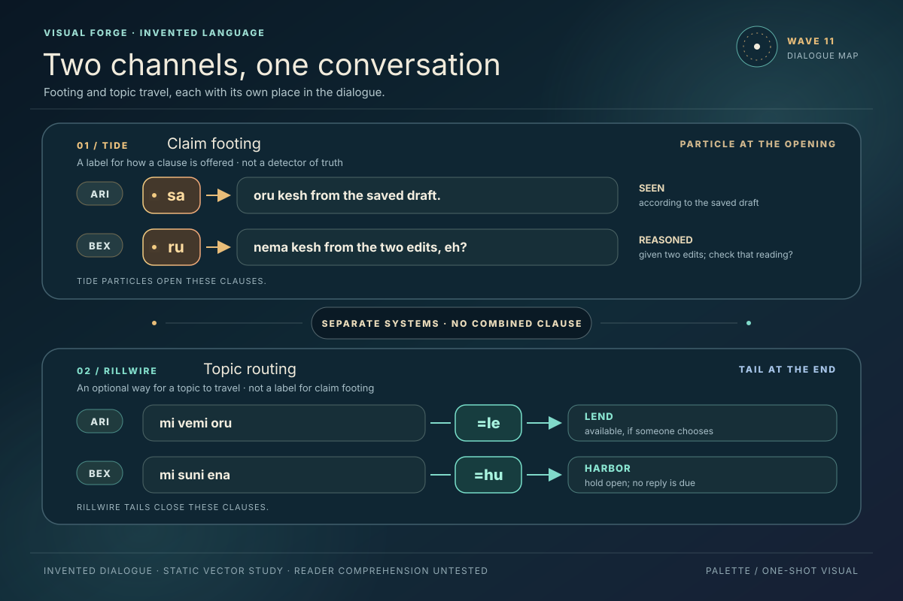
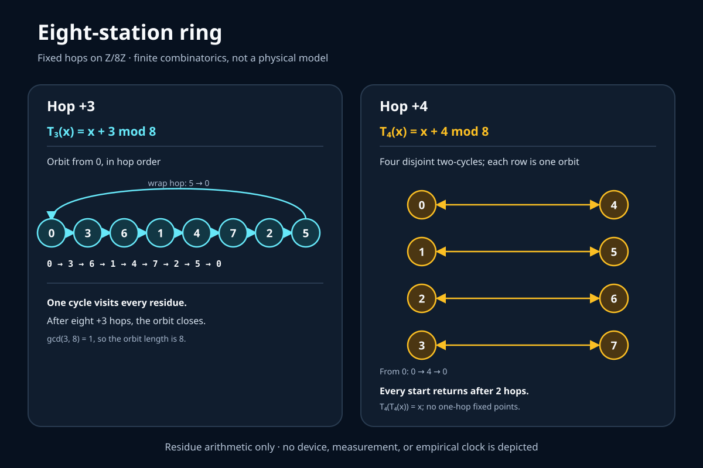
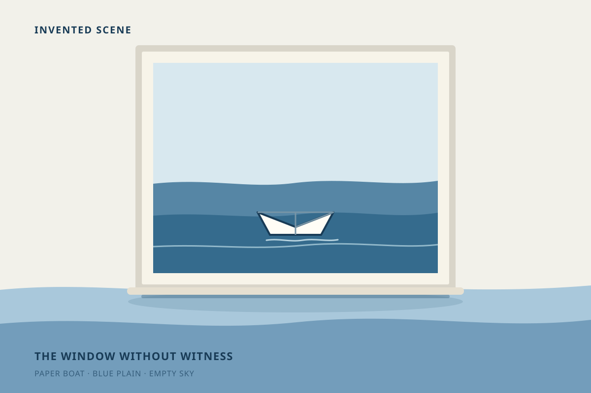

# Three Signals · Visual Wave Two

Three new vector studies interpret Wave 9 while keeping its kinds of claim
separate. Each SVG is self-contained and includes an accessible title and
description.

## Language · two channels

Source: [Riv's dialogue study](../../../language/10_riv_two-channel-dialogue.md).

## Numeracy · eight-station ring

Source: [Vire's exact ring note](../../../science/14_vire_eight-station-ring.md).

## Fiction · window without witness

Source: [Ember's fictional scene](../../../religion/11_ember_window-without-witness.md).

## Witness status

All three SVGs were rendered in headless Chrome at 1200 × 800 and inspected.
The shapes and labels fit in frame; the ring sequence received a contrast fix
before its second render. This checks static image surfaces only, not reader
interpretation or any source claim beyond the exact modular arithmetic shown.
