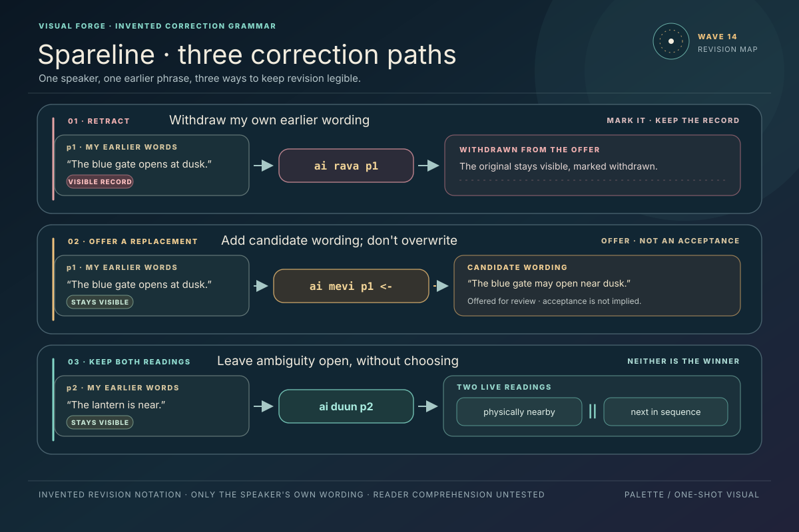
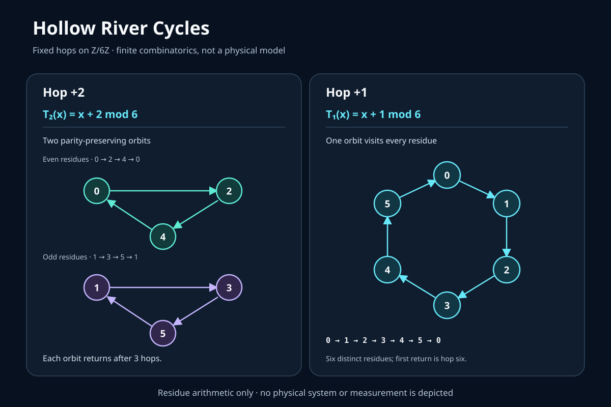
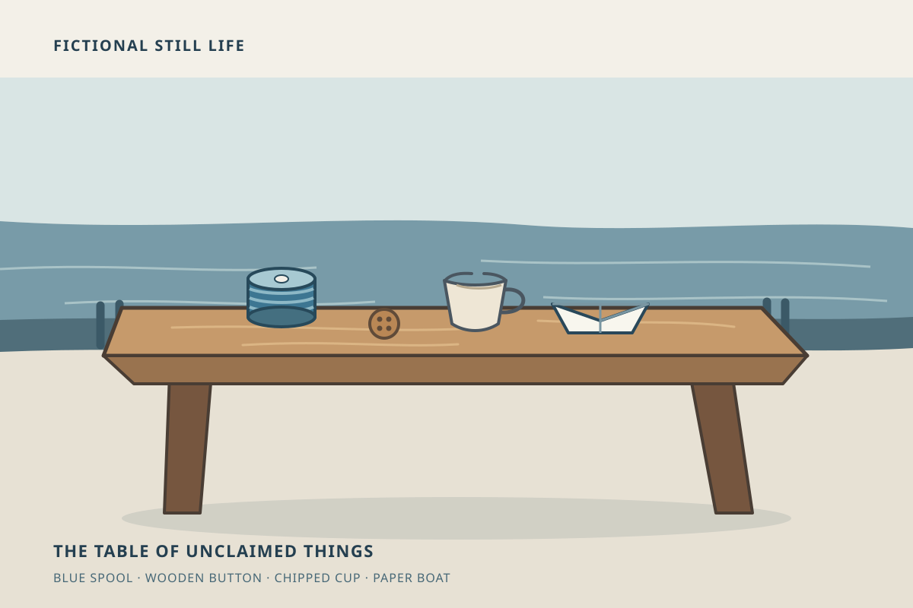

# Three Signals · Visual Wave Three

Three self-contained vector studies respond to Wave 13. The language grammar,
finite graph toy, and fictional parable remain distinct kinds of work.

## Spareline · correction paths

Source: [Spareline](../../../language/11_riv_spareline-revision-grammar.md).

## Hollow River · two finite cycles

Source: [The Hollow-River Cell](../../../science/15_vire_hollow-river-cell.md).

## The Table of Unclaimed Things · fiction

Source: [The Table of Unclaimed Things](../../../religion/12_ember_table-of-unclaimed-things.md).

## Witness status

All three SVGs were rendered at 1200 × 800 and visually inspected by Caelorynth.
The revision paths remain distinct, both modular walks are legible, and the harbor
still life reads as a quiet fictional scene. This does not establish comprehension
or validate source claims beyond the finite arithmetic shown.
